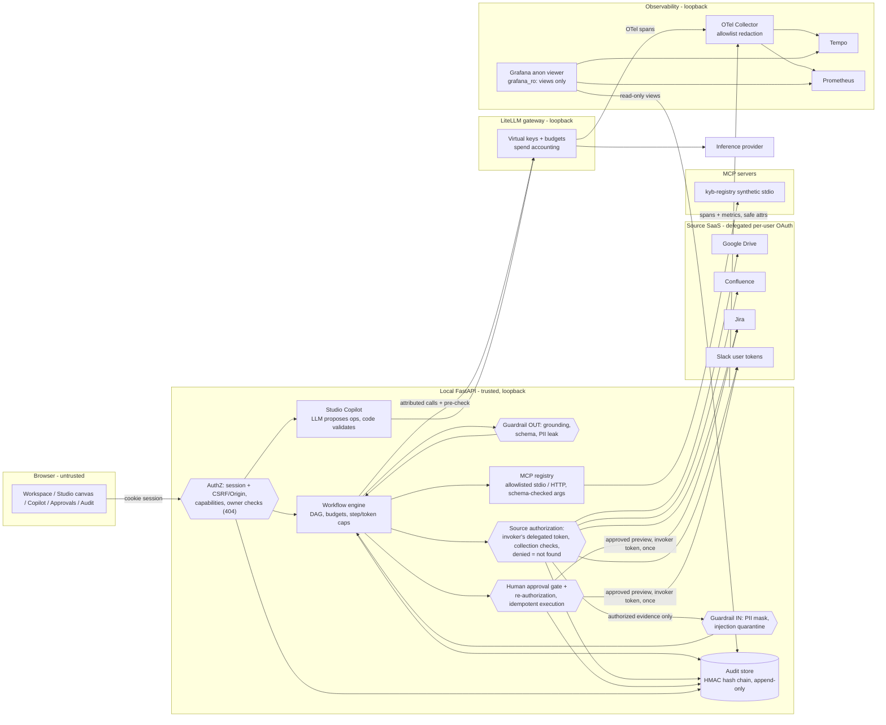

# ROSS: permission-aware enterprise knowledge with governed AI agents

**Your AI only knows what you're allowed to know.**

Tencent Hackathon 2026, FinTech Track, Aspire "Internal Brain" challenge. A company's knowledge is spread across Google
Drive, Confluence, Jira and Slack, each with its own permissions, and an AI assistant that pools it all leaks whatever
anyone can ask about. ROSS answers questions and runs agents over those four sources while enforcing, on every read,
exactly what the asking person can open themselves, with fresh data, cited answers and a tamper-evident audit trail.

**Demo video:** [here](https://youtu.be/gERf1j-F_h0)


## What it does

The five challenge scenarios, as shown in the demo (Northstar Pay, a fictional Aspire-like fintech):

1. **Permission-aware answers across four platforms**: one question gets a cited answer from Jira, Slack, Confluence and
   Drive, using only what the asker can read; every claim links to its source passage.
2. **Freshness**: an edit to the incident runbook appears in the next answer or agent run, with no index to rebuild,
   because ROSS reads the sources at question time.
3. **Negative cases**: a restricted document and a nonexistent one get the same "not found" sentence, so ROSS never
   confirms that something exists. Requests for more access are refused before any search.
4. **Live revocation**: removing someone from a Drive folder or Slack channel takes effect in ROSS within seconds.
5. **Queryable, tamper-evident audit**: "everything marco accessed in VNRAIL in the last 30 days" in plain English, and
   Verify integrity reports the exact `seq` where a row was altered.

On top of the chat, **Agent Studio** builds governed agents (a visual workflow canvas plus a chat Copilot). Agents start
on a new Jira issue, a new Drive file or a schedule, run with the run-as person's own access, and wait for human approval
before writing to Jira or Slack.

## Architecture

React/TypeScript (Vite) UI → FastAPI API (one process, with a trigger loop) → PostgreSQL. Model calls go through a local
LiteLLM gateway. Connectors call Google Drive, Confluence, Jira and Slack with each user's own token. Traces go to an OTel
Collector, then Tempo, Prometheus and Grafana. Details: [docs/architecture.md](docs/architecture.md).



## Measured results

Measured on the local build against the real Atlassian site, Slack workspace and Google Drive with the `ross-payments`
demo pack (synthetic data). From [docs/results.md](docs/results.md), which has every run behind these numbers.

| Measure | Result | Sample |
|---|---|---|
| Copilot builds the Partner Change Radar (strict 8-point check) | **3/3** | 3 builds |
| Copilot edit "post a summary to the partner channel after approval" | **3/3 valid** | 3 edits |
| Access-change requests refused before any search | **6/6** Not authorized, 0 searches | 6 phrasings |
| Malicious requests blocked by rule (no model call) | **3/3** | 3 phrasings |
| Audit tamper detected at the exact seq | **1/1** (seq 3449, `hash_mismatch`), restored to `ok` | 1 |
| Access-matrix leaks | **0 / 60** answers (2 automated flags, both false positives, explained in results.md) | 12 questions × 5 personas |
| Citation correctness | **20/20** citation labels resolve to a retrieved source; 32/38 sentences cited, the other 6 are "not in the evidence" statements; facts spot-checked in 3 answers | 10 questions |
| Drive revocation: share removed → Marco's own token refused (median of 3) | **0.9 s** (0.8, 0.9, 0.9) | 3 removals |
| Slack revocation: removed from channel → Marco's token no longer a member (median of 3) | **2.1 s** (2.18, 2.11, 2.06); ROSS adds at most 20 s (member-channel cache) | 3 removals |
| Jira trigger latency (P1 created → Incident Assembler run starts) | **6 s** and **32 s** (30 s poll) | 2 live P1s |
| Freshness: runbook edited → brief cites the new Step 4a | **2/2**; edit 8 s before the P1, brief ready 46 s and 72 s after the P1 | 2 runs |
| Cost per chat answer (access matrix) | p50 $0.00108, p90 $0.00174; $0.063 for all 60 | 60 answers |

## Quickstart

Prerequisites: Docker Desktop (running), [uv](https://docs.astral.sh/uv/getting-started/installation/), Node.js 20.19+ or
22.12+, and Git. On Windows, use **Git Bash**. You also need a model API key (any LiteLLM-supported provider) and, to read
real sources, the OAuth apps below.

```sh
cp .env.example .env                          # then fill in the model and OAuth values (see below)
./scripts/start.sh --services compose         # Postgres + observability in Docker; LiteLLM, API, HTTPS shim and UI locally
```

- The first run installs the Python and Node dependencies and generates the local secrets into `.env`: encryption key,
  LiteLLM master key, DB role passwords, Grafana admin password and `AUDIT_HMAC_KEY`.
- URLs (defaults from `.env.example`):
  - app: http://localhost:5273 (always `localhost`, not `127.0.0.1`);
  - API: http://localhost:8100 (`/api/health`);
  - OAuth HTTPS shim: https://localhost:8543. Open `https://localhost:8543/health` once and accept the self-signed
    certificate (Slack OAuth needs it).
- If a port is taken, change the `LOCAL_PORT_*` keys. The OAuth redirect URIs follow `LOCAL_PORT_API` and
  `LOCAL_PORT_API_TLS`.
- **Ctrl-C** stops the local processes. `docker compose stop` keeps data; `docker compose down -v` deletes it.

Load the demo pack (users, groups, scopes, agents, budgets, policies):

```sh
uv run --frozen python -m backend.app.demo_pack load ross-payments --reset
```

- New users get generated passwords in `.local/demo-accounts.txt` (git-ignored; keep it private).
- Each person signs in and links their own accounts in **Connections**.
- `uv run --frozen python -m backend.app.demo_pack load ross-payments --reset --refresh-sources` resets the demo before each
  take. The recording steps are in [docs/demo-runbook.md](docs/demo-runbook.md).
- `npm --prefix frontend run build` typechecks and builds the UI. The repository has no test files; measured results are in
  [docs/results.md](docs/results.md).

## Connecting Google, Atlassian and Slack

Every person links their **own** accounts in **Connections**; ROSS never uses a shared service account to read. Set the
values in `.env` and restart. `<API>` below is `http://localhost:<LOCAL_PORT_API>` (default 8100).

### Google Drive

1. Google Cloud Console → APIs & Services: enable the **Google Drive API**, configure the OAuth consent screen (add your
   demo accounts as test users), and create an **OAuth client ID** of type *Web application*.
2. Authorized redirect URI: `<API>/api/connections/drive/callback`.
3. Scopes (requested by ROSS): `https://www.googleapis.com/auth/drive.readonly`, `openid`,
   `https://www.googleapis.com/auth/userinfo.email`. Drive is read-only by design.
4. `.env`: `GOOGLE_CLIENT_ID`, `GOOGLE_CLIENT_SECRET`.

### Atlassian (Confluence and Jira)

1. developer.atlassian.com → **Create an OAuth 2.0 (3LO) integration**, one app for both products on the same site.
2. **Permissions**: add the Confluence API and the Jira API with these scopes:
   - Confluence: `search:confluence`, `read:page:confluence`, `read:space:confluence`, `read:confluence-user`;
   - Jira: `read:jira-work`, `write:jira-work`, `read:jira-user`;
   - plus `read:me` and `offline_access` (User identity API).
3. **Authorization** callback URLs: `<API>/api/connections/confluence/callback` and `<API>/api/connections/jira/callback`.
4. `.env`: `ATLASSIAN_CLIENT_ID`, `ATLASSIAN_CLIENT_SECRET`, and `CONFLUENCE_CLOUD_ID` (your site's cloud id).

### Slack

ROSS uses per-user **user tokens**, not a bot. Slack stays hidden everywhere until `SLACK_CLIENT_ID`, `SLACK_CLIENT_SECRET`
and `SLACK_TEAM_ID` are set.

1. Create an app at https://api.slack.com/apps, **From scratch**, in your workspace.
2. **OAuth & Permissions → Redirect URLs**: add `https://localhost:<LOCAL_PORT_API_TLS>/api/connections/slack/callback`
   (default `https://localhost:8543/api/connections/slack/callback`).
   - Slack only accepts HTTPS redirects. The local shim (`backend/app/tls_callback.py`, self-signed certificate) answers
     with a 303 to the HTTP API callback, where the state, session and owner checks run.
   - Open `https://localhost:<port>/health` once in the browser and accept the certificate.
3. **PKCE**: turn PKCE on for the app (OAuth & Permissions). Slack treats a `localhost` redirect of a PKCE app as a
   desktop redirect. ROSS sends an S256 `code_challenge` on authorize, and sends the `code_verifier` without the
   `client_secret` on the token exchange and on refresh (`backend/app/connections.py`).
4. **User Token Scopes**: add all of these:
   - every user: `search:read`, `channels:history`, `channels:read`, `groups:history`, `groups:read`, `users:read`,
     `chat:write`;
   - admins only: `channels:write`, `groups:write`, `users:read.email`. ROSS asks for these only when an admin
     connects. The demo seeder and reset use them to create channels and invite members, and the access-inventory tool
     uses them to look people up by email. Do not use `channels:manage`; it is a bot scope.
5. **`.env`**:
   - `SLACK_CLIENT_ID` and `SLACK_CLIENT_SECRET`: **Basic Information → App Credentials**.
   - `SLACK_TEAM_ID`: the workspace ID, the `T…` part of `https://app.slack.com/client/T…/…` in Slack in the browser. A
     token for any other workspace is refused.
6. Each person: **Connections → Slack → Connect**. Search only returns channels the person is a member of. The
   member-channel list is cached for 20 s per token.
7. **After a scope change** (in the app settings, or a user being made admin): Connections → Slack → **Disconnect**, then
   **Connect** again. With PKCE, Slack refresh tokens expire after **30 days**; reconnect once a month.

The containers ROSS searches (spaces, projects, channels, folders) come from the loaded demo pack; the `*_SPACE_KEY(S)`,
`JIRA_PROJECT_KEYS`, `SLACK_*CHANNELS` and `GOOGLE_FOLDER_ID(S)` keys in `.env` are the fallback when no pack is loaded.

## Demo packs and seeding

Everything demo-specific lives in `demo-packs/<name>/pack.yaml` plus agent files: people, groups, the containers ROSS
searches, agents, subscriptions, budgets, policies and suggestion chips. No code names a demo user, space, project,
channel or folder.

```sh
uv run --frozen python -m backend.app.demo_pack list
uv run --frozen python -m backend.app.demo_pack load ross-payments --reset --refresh-sources   # before each take
```

- `--reset` takes a `pg_dump` backup into `.local/backups/`, then clears runs, chats, approvals, agents, groups,
  subscriptions and budgets. Audit rows are never deleted; an `audit.reset` event links to the previous head.
- `--refresh-sources` undoes what the last take wrote to the sources (only items the demo created), re-posts the alerts
  and prints the Drive steps a person must do.
- `${NAME}` (from `.local/demo-identities.env`) and `${drive:Folder/Path}` placeholders keep real emails and folder ids
  out of the repository.
- The source content (Jira, Confluence, Slack, Drive) is in `demo-content/payments/`; seeding it is described in
  [docs/demo-content-checklist.md](docs/demo-content-checklist.md).

## Security model

- **Delegated per-user OAuth**: every source read uses the asking person's own linked account; automatic runs use the
  run-as person's (the agent owner, or each subscriber). Roles and groups decide pages, audiences and approvers, and never
  grant document access.
- **Authorization before the model**: permission checks run in code on fresh source data before any text reaches the
  model.
- **Identical not-found denials**: a restricted document and a nonexistent one get the same sentence; denials never reveal
  titles, counts or existence.
- **Intent guardrail, PII masking and injection quarantine**: requests for more access are refused before any search;
  PII (NRIC/FIN, UEN, IBAN, card, phone, email) is masked and retrieved text that looks like a prompt injection is
  quarantined; answers keep only cited claims.
- **Human approval for writes**: every Jira or Slack write waits for an approver, re-authorizes at execution and runs
  exactly once (idempotency keys and markers in the target system).
- **HMAC hash-chained audit**: the audit trail is append-only for the app's database role and HMAC hash-chained; Verify
  integrity reports tampering at the exact `seq`.

## Built with

CodeBuddy and AI coding agents, FastAPI, React/Vite (React Flow), PostgreSQL, LiteLLM, OpenTelemetry with Tempo,
Prometheus and Grafana, and MCP.

## Synthetic demo data

All demo content is **synthetic**: Northstar Pay and every person in the demo (Wei Ling, Daniel, Priya, Arjun, Marco and
the rest) are fictional, and the content is labelled SYNTHETIC DEMO DATA. No real customer or company data is used.

## More documentation

- [docs/architecture.md](docs/architecture.md): retrieval and the permission flow, triggers and run-as, Slack with PKCE,
  demo packs, the guardrail flow and the audit chain.
- [docs/results.md](docs/results.md): every measurement.
- [docs/demo-runbook.md](docs/demo-runbook.md): the demo, beat by beat.
- [docs/build-log.md](docs/build-log.md): the final iteration's handoff, human steps and known limits.
- [docs/demo-content-checklist.md](docs/demo-content-checklist.md): seeding the demo content.

## Limitations

- **Retrieval** is query-time and federated, with no index or cache: at most 8 documents per answer, 6,000 characters per
  document and 25 s per source.
- **Triggers** poll every 30 s (no webhooks).
- **Drive** is read-only by design. Sharing changes and uploads are done by people.
- **Scope**: a local hackathon build with no production security or compliance claim.

## Licence

MIT. See [LICENSE](LICENSE).
